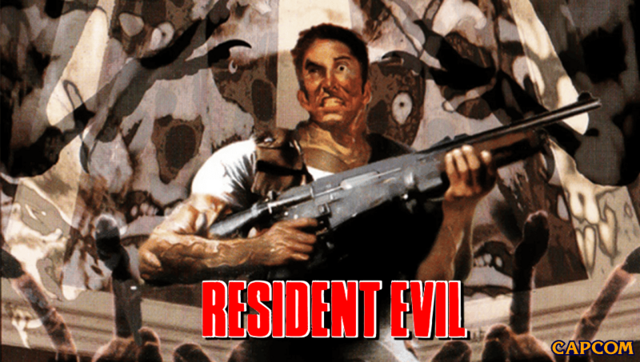

<p align="center">
  
</p>

A PS Vita port of the Resident Evil 1 PC decompilation. It's the 1997 PC game's own code, rebuilt
from the [decomp](https://github.com/ecruells/resident-evil-pc-decomp) with a new platform layer
for the Vita: vitaGL for the renderer, sceCtrl and the touch panel for input, SceAudio for sound,
ffmpeg and SceAvPlayer for the movies.

> [!IMPORTANT]
> **No game files are included here or in the release.** You need your own copy of the PC
> version (the GOG release works, it's the same build as the 1997 disc).
>
> The Japanese MediaKite release (Biohazard) can sit next to it as `JPN/`, and the Director's
> Cut mode needs a `DC/` folder made with the asset migrator from the upstream project.

## Download & Install

Grab `residentevil.vpk` from the [Releases](../../releases) page and install it with VitaShell.

The shader compiler is needed at `ur0:data/libshacccg.suprx`. If you don't have it yet, extract
it with [ShaRKBR33D](https://github.com/Rinnegatamante/ShaRKBR33D).

Then the game files. Copy the folder of your PC install that has `Stage1`, `Movie`, `Sound` and
the rest in it to the memory card and call it `USA`, like this:

```
ux0:data/RE1/
├── USA/
│   ├── Data/
│   ├── Movie/
│   ├── Stage1/ ... Stage7/
│   └── ...
├── JPN/          (optional)
├── DC/           (optional)
└── mods/         (optional, see below)
```

`config.ini` and the `SAVE/` folder are created there on the first boot. Your PC saves
(`savedat1.dat` to `savedat9.dat`) can go straight into `SAVE/`, they load as they are.

## Controls

<p align="center">
  
</p>

| Vita | In game |
|---|---|
| Left stick / D-Pad | move |
| Cross | action, confirm |
| Circle | cancel, hold to run |
| Square / L / R | aim |
| Triangle / Start | inventory |
| Select | options |
| Right stick flick | next / previous weapon (WEAPON SWAP on) |
| L + R + Select | port settings |

Tapping the top right corner of the front screen also opens the port settings.

## Settings

<p align="center">
  
</p>

The settings panel has three pages, flipped with L and R. The game keeps running behind it.

* **VIDEO:** aspect (4:3, Integer 640x480 or Stretch), nearest or linear filtering, gamma, MSAA
  (applies on the next boot) and the frame rate.
* **GAMEPLAY:** auto run, weapon swap on the right stick, skip the door animations, the status
  and weapon HUD, HUD auto hide, and EDIT HUD, where you drag the two HUD boxes around with a
  finger and pinch them to size. On a PS TV pick one with Square, move it with the D-Pad and size
  it with L/R.
* **SAVES:** three quick save slots with a thumbnail of where you saved. They're regular saves
  of the room you're in, so they're safe to use anywhere you can move.

Everything is saved to the `[Vita]` section of `config.ini`, which you can also edit by hand.

### 60 FPS

`FrameRate=60` (or FRAME RATE on the VIDEO page) works the way REuncap does on the PC: the game
still runs at its original 30 ticks a second, so nothing gets faster, but an extra frame is
drawn between ticks with every 3D model halfway between where it was and where it is. Menus,
movies and the backgrounds stay at 30. It turns VSync on while it's set, and adds about 16 ms of
input lag.

### HUD auto hide

With `HudAutoHide=1` the HUD fades out after a few seconds of nothing happening and comes back
when you get hit, shoot, aim or change weapon.

## Mods

Mods go in `ux0:data/RE1/mods/<name>/` and are turned on in `config.ini`:

```ini
[Mods]
Load=MyRooms,HQMovies
```

A mod is just a copy of the parts of the game tree it changes, with the same folder and file
names. Rooms (`stage1/room1060.rdt`), backgrounds (`stage1/rc1060.pak`), textures (`.tim`,
`.pix`), sounds, voices and movies all work. If two mods replace the same file the one that's
first in the list wins. Movies can be `.mp4` (H.264 with AAC audio), so an mp4 movie pack goes
in like this:

```
ux0:data/RE1/mods/HQMovies/movie/capcom.mp4
```

Texture packs that come as a `hires/` folder of `.webp` files named by hash (the TeamX HD mod,
Seamless HD Project) are made for Classic REbirth and don't load here.

## Known issues

* 60 FPS doesn't smooth the shadows, blood and effects yet, they move at 30.
* Settings changed in the game's own Option Mode are lost if you close the game from the
  LiveArea instead of quitting from the title screen.

## AI Assistance

Parts of the Vita port were written or improved with the assistance of AI (Claude, by Anthropic).
All AI-assisted code was reviewed, tested on hardware, and manually validated, with the overall
implementation and debugging process remaining under human supervision.

## Credits

* **Capcom** for Resident Evil. This project isn't affiliated with Capcom.
* **ecruells** and everyone on the [Resident Evil PC decompilation](https://github.com/ecruells/resident-evil-pc-decomp),
  which this is built on. The PC build's own README is in `docs/PC_README.md`.
* **Rinnegatamante** for vitaGL and vitaShaRK.
* The **VitaSDK** team.
* **NobodyCatchMe-AZ92** for REuncap, which the 60 FPS mode follows.

## Building from source

You need [VitaSDK](https://vitasdk.org) with vitaGL, vitaShaRK and the ffmpeg package installed
through vdpm, and `VITASDK` set:

```bash
cmake -S . -B build/vita -DCMAKE_TOOLCHAIN_FILE=$VITASDK/share/vita.toolchain.cmake -DCMAKE_BUILD_TYPE=Release
cmake --build build/vita -j
```

The VPK ends up as `build/vita/residentevil.vpk`. The LiveArea art is in `vita/sce_sys/`.

The Windows and Linux builds still work the same as upstream, see `docs/PC_README.md`.
