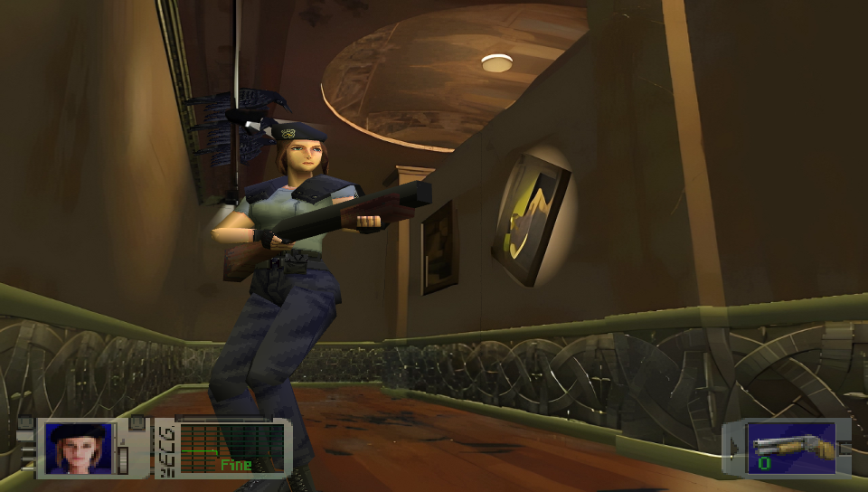
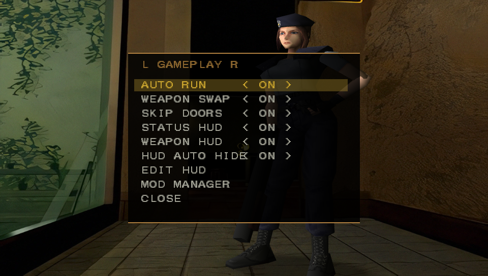
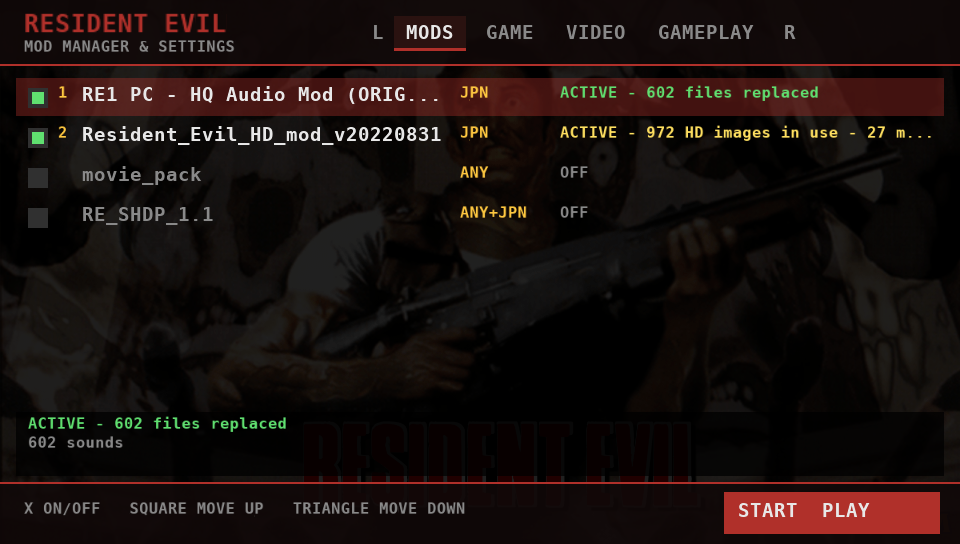
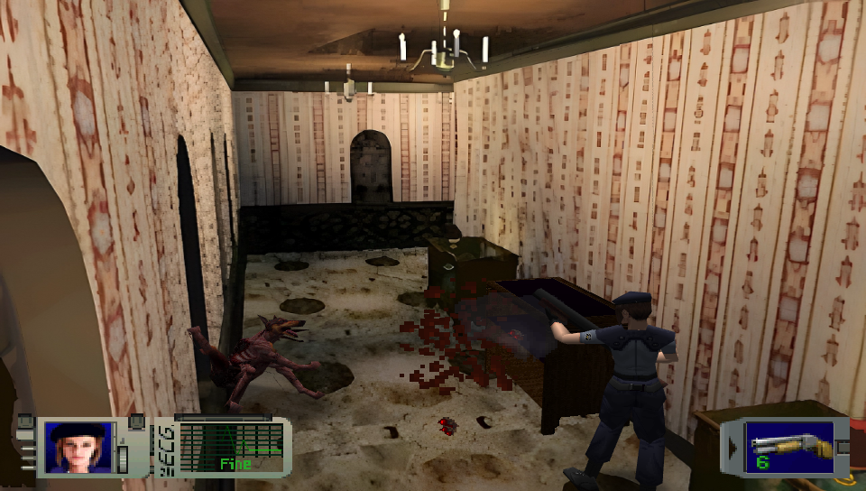

<p align="center">
  
</p>

A PS Vita port of the Resident Evil 1 PC decompilation. It's the 1997 PC game's own code, rebuilt
from the [decomp](https://github.com/ecruells/resident-evil-pc-decomp) with a new platform layer
for the Vita: vitaGL for the renderer, sceCtrl and the touch panel for input, SceAudio for sound,
ffmpeg and SceAvPlayer for the movies.

> [!IMPORTANT]
> **No game files are included here or in the release.** You need your own copy of the PC
> version (the GOG release works, it's the same build as the 1997 disc).
>
> The Japanese MediaKite release (Biohazard) can sit next to it as `JPN/`, and the Director's
> Cut mode needs a `DC/` folder made with the asset migrator from the upstream project.

## Download & Install

Grab `residentevil.vpk` from the [Releases](../../releases) page and install it with VitaShell.

The shader compiler is needed at `ur0:data/libshacccg.suprx`. If you don't have it yet, extract
it with [ShaRKBR33D](https://github.com/Rinnegatamante/ShaRKBR33D).

Then the game files. Copy the folder of your PC install that has `Stage1`, `Movie`, `Sound` and
the rest in it to the memory card and call it `USA`, like this:

```
ux0:data/RE1/
├── USA/
│   ├── Data/
│   ├── Movie/
│   ├── Stage1/ ... Stage7/
│   └── ...
├── JPN/          (optional)
├── DC/           (optional)
└── mods/         (optional, see below)
```

`config.ini` and the `SAVE/` folder are created there on the first boot. Your PC saves
(`savedat1.dat` to `savedat9.dat`) can go straight into `SAVE/`, they load as they are.

## Controls

<p align="center">
  
</p>

| Vita | In game |
|---|---|
| Left stick / D-Pad | move |
| Cross | action, confirm |
| Circle | cancel, hold to run |
| Square / L / R | aim |
| Triangle / Start | inventory |
| Select | options |
| Right stick flick | next / previous weapon (WEAPON SWAP on) |
| L + R + Select | port settings |

Tapping the top right corner of the front screen also opens the port settings. Holding SELECT
while the game boots opens the [mod manager](#mod-manager).

## Settings

<p align="center">
  
</p>

The settings panel has three pages, flipped with L and R. It opens on QUICK SAVES, and the game
keeps running behind it.

* **QUICK SAVES:** three quick save slots with a thumbnail of where you saved. They're regular
  saves of the room you're in, so they're safe to use anywhere you can move.
* **VIDEO:** aspect (4:3, Integer 640x480 or Stretch), nearest or linear filtering, gamma, MSAA
  (applies on the next boot) and the frame rate.
* **GAMEPLAY:** auto run, weapon swap on the right stick, skip the door animations, the status
  and weapon HUD, HUD auto hide, and EDIT HUD, where you drag the two HUD boxes around with a
  finger and pinch them to size. On a PS TV pick one with Square, move it with the D-Pad and size
  it with L/R. MOD MANAGER restarts the game into the mod manager.

Everything is saved to the `[Vita]` section of `config.ini`, which you can also edit by hand.

### 60 FPS

`FrameRate=60` is the default (FRAME RATE on the VIDEO page switches back to 30). It works the way REuncap does on the PC: the game
still runs at its original 30 ticks a second, so nothing gets faster, but an extra frame is
drawn between ticks with every 3D model halfway between where it was and where it is. Menus,
movies and the backgrounds stay at 30. It turns VSync on while it's set, and adds about 16 ms of
input lag.

### HUD auto hide

With `HudAutoHide=1` the HUD fades out after a few seconds of nothing happening and comes back
when you get hit, shoot, aim or change weapon.

## Mod manager

<p align="center">
  
</p>

The mod manager runs before the game starts. Open it with the **Mod Manager & Settings** button
on the LiveArea page, by holding **SELECT** while the game boots, or from MOD MANAGER in the
settings panel.

* **MODS:** every folder in `ux0:data/RE1/mods/`. X turns a mod on or off, Square and Triangle
  change the load order (the first one wins when two replace the same file). Each mod says what
  it's doing, and in red when it does nothing for the version you're playing.
* **GAME:** USA or JPN, original or Director's Cut (when `JPN/` and `DC/` are there).
* **VIDEO** and **GAMEPLAY:** the same options as the in-game panel, plus HD TEXTURES and HD
  TEXTURE SIZE.

START saves it all to `config.ini` and starts the game.

### Optimize for Vita

Press **SELECT** on a mod to optimize it on the console, no PC needed. The mod manager first shows
what it will do and a warning: it **overwrites the mod's own files and can't be undone**, and a big
pack with movies can take an hour or more. Hold X for three seconds to start.

* HD backgrounds become JPEGs and masks a compact format, already scaled to HD TEXTURE SIZE. They
  load several times faster than the WebP originals, so the game waits for the HD picture instead
  of showing the original background first: no more pop-in. The originals are deleted as each one
  is converted, so the mod doesn't take extra space (Seamless HD's pictures went from 334 MB to
  about 200 MB in testing).
* Movies the Vita can't play are converted: H.264 inside AVI (TeamX) is re-packed into MP4 in
  seconds, and High 4:4:4 packs are re-encoded to MPEG-4 at 640x480, which is slow.
* Files the port never uses are deleted: `hires/skin`, `skin2`, `misc`, `.dll` and `.asi` files,
  and `bio1dc/` when no `DC/` folder is installed.

CIRCLE stops it; whatever is done stays converted and running OPTIMIZE again finishes the rest.
Because the size is fixed when you optimize, keep a copy of the pack on a PC if you may want a
different HD TEXTURE SIZE later.

## Mods

A mod is a folder in `ux0:data/RE1/mods/` holding a copy of the parts of the game tree it changes,
with the same folder and file names. Rooms (`stage1/room1060.rdt`), backgrounds
(`stage1/rc1060.pak`), textures, sounds, voices and movies all work. A mod can also keep its files
under `USA/` or `JPN/` inside its folder, the way the HQ audio mod ships.

You can turn them on in the mod manager, or by hand:

```ini
[Mods]
Load=SHDP,HQ_Audio,Movies
```

The full list of tested mods and how to install each one is in [docs/MODS.md](docs/MODS.md).

### HD packs

<p align="center">
  
</p>

The Classic REbirth background packs, the **Seamless HD Project** and **TeamX's HD mod**, work:
copy the pack's `hires/` folder into a mod folder (`mods/SHDP/hires/bgd`, `mods/SHDP/hires/mask`).
Backgrounds and the masks over them are swapped in for 591 room cameras, scaled to `HdMaxHeight`
(480, 720 or 960, 720 by default). The packs' character and item textures aren't supported yet.

A pack works as you copy it, but its WebP pictures are slow to decode on the Vita and a camera cut
can show the original background for a moment. [Optimize](#optimize-for-vita) the mod once to fix
that.

### Movies

Movies can be `.mp4` (H.264 with AAC audio): `mods/Movies/movie/capcom.mp4`. The Vita's decoder
only plays 4:2:0 H.264, so many packs (High 4:4:4, H.264 inside AVI) don't play as they come; the
mod manager says when a pack has movies it can't play, and [OPTIMIZE](#optimize-for-vita) converts
them on the console.

If you'd rather do it on a PC (much faster for big packs),
[`tools/vita/convert_movies.py`](tools/vita/convert_movies.py) does the same conversion with
`ffmpeg` and writes a ready mod folder: `python3 tools/vita/convert_movies.py path/to/pack`, or drag
the folder onto `convert_movies.bat` on Windows.

Download links for every tested mod are in [docs/MODS.md](docs/MODS.md).

## AI Assistance

Parts of the Vita port were written or improved with the assistance of AI (Claude, by Anthropic).
All AI-assisted code was reviewed, tested on hardware, and manually validated, with the overall
implementation and debugging process remaining under human supervision.

## Credits

* **Capcom** for Resident Evil. This project isn't affiliated with Capcom.
* **ecruells** and everyone on the [Resident Evil PC decompilation](https://github.com/ecruells/resident-evil-pc-decomp),
  which this is built on. The PC build's own README is in `docs/PC_README.md`.
* **Rinnegatamante** for vitaGL and vitaShaRK.
* The **VitaSDK** team.
* **NobodyCatchMe-AZ92** for REuncap, which the 60 FPS mode follows.
* The **Seamless HD Project** team (MoArtis, Kayael, Doze_D, FrankWesker) and **TeamX** for the HD
  packs the port can load. Neither is included.

## Building from source

You need [VitaSDK](https://vitasdk.org) with vitaGL, vitaShaRK, and the ffmpeg, libwebp,
libjpeg-turbo and libpng packages installed through vdpm, and `VITASDK` set:

```bash
cmake -S . -B build/vita -DCMAKE_TOOLCHAIN_FILE=$VITASDK/share/vita.toolchain.cmake -DCMAKE_BUILD_TYPE=Release
cmake --build build/vita -j
```

For the mod manager's movie conversion of 4:4:4 packs, build FFmpeg with its H.264 decoder (the
vdpm package has none) and point CMake at it. Without it everything else works and those packs
are reported as not convertible.

```bash
tools/vita/build_ffmpeg.sh ../ffmpeg-vita
cmake -S . -B build/vita -DCMAKE_TOOLCHAIN_FILE=$VITASDK/share/vita.toolchain.cmake -DCMAKE_BUILD_TYPE=Release -DRE1_FFMPEG_PREFIX=../ffmpeg-vita
```

The VPK ends up as `build/vita/residentevil.vpk`. The LiveArea art and template (with the mod
manager button) are in `vita/sce_sys/`, and `vita/hd_map.txt`, the HD pack room map, is packed
into the VPK. `tools/vita/hd_map.py` rebuilds it and `tools/vita/make_menu_font.py` the mod
manager's font.

The Windows and Linux builds still work the same as upstream, see `docs/PC_README.md`.
